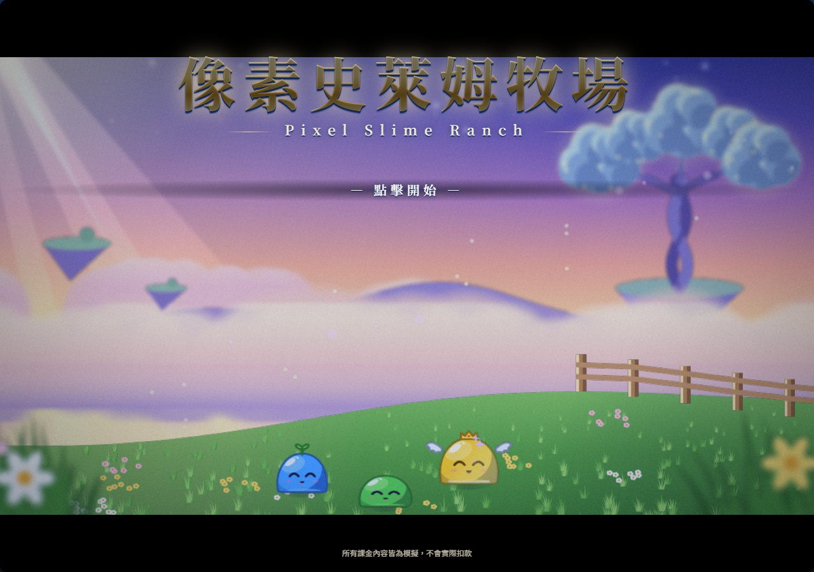
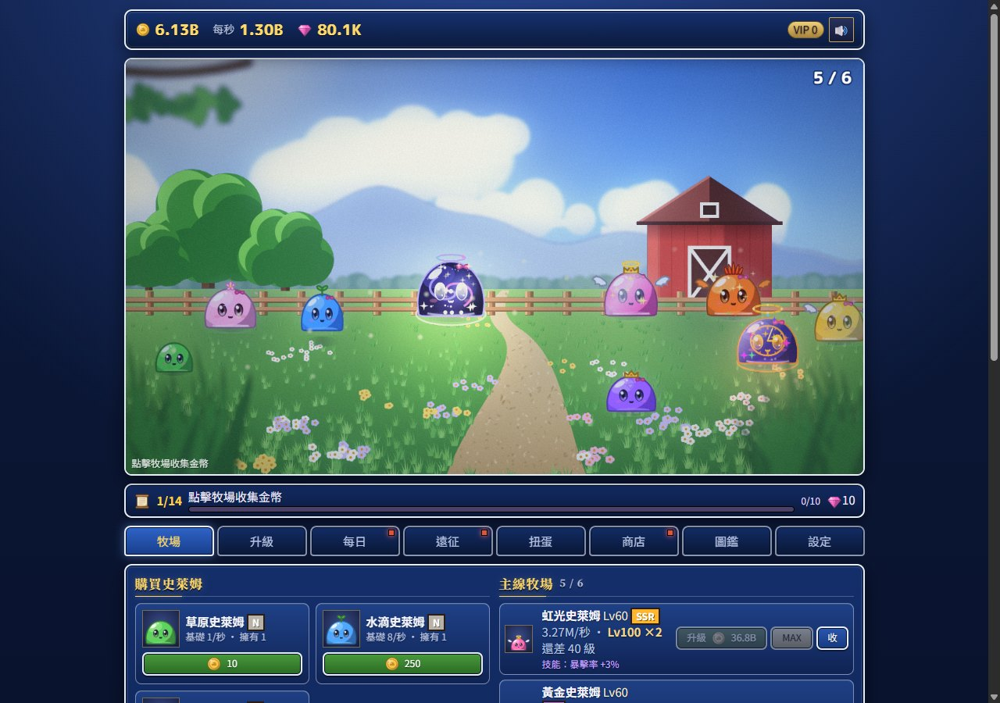
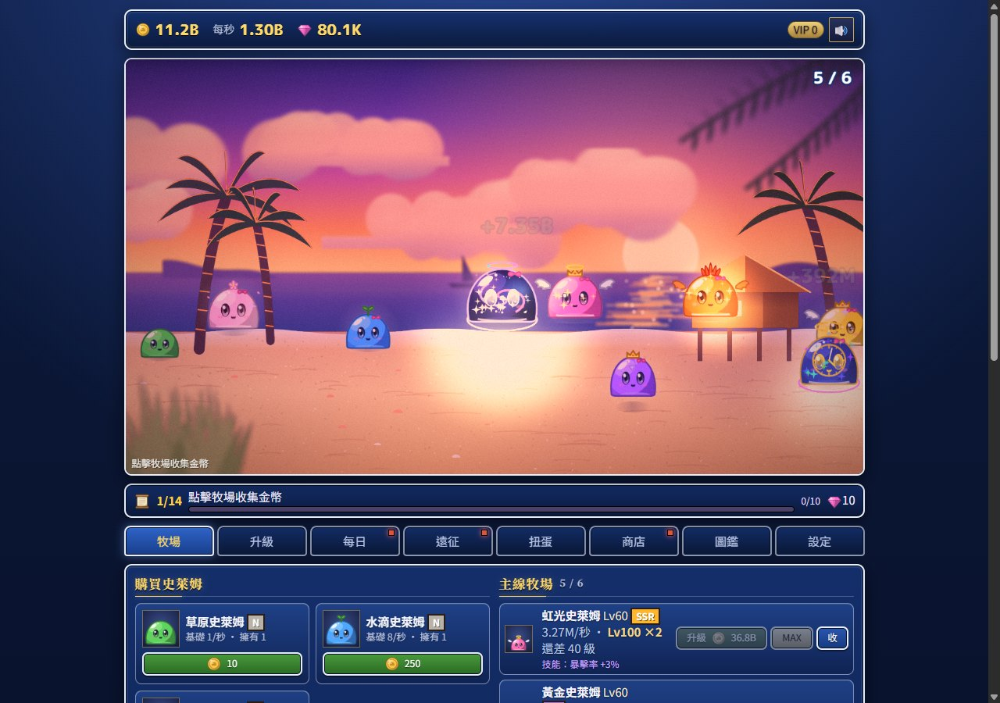
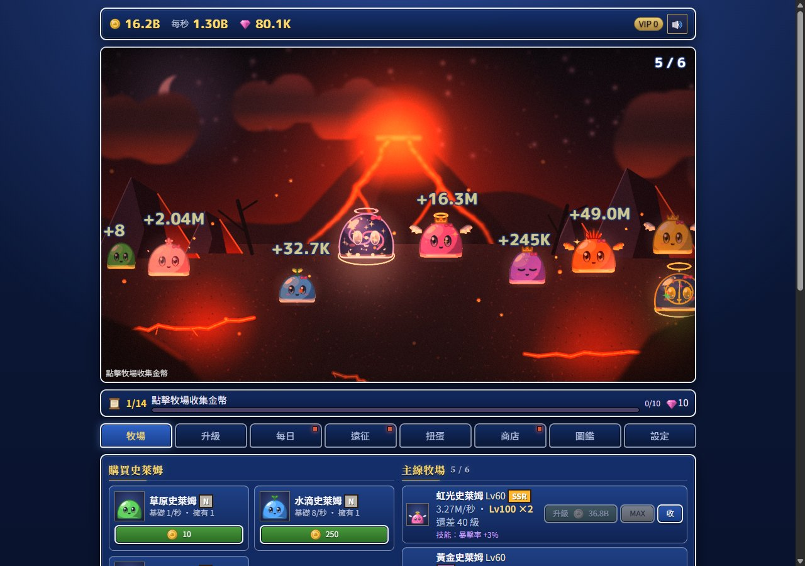
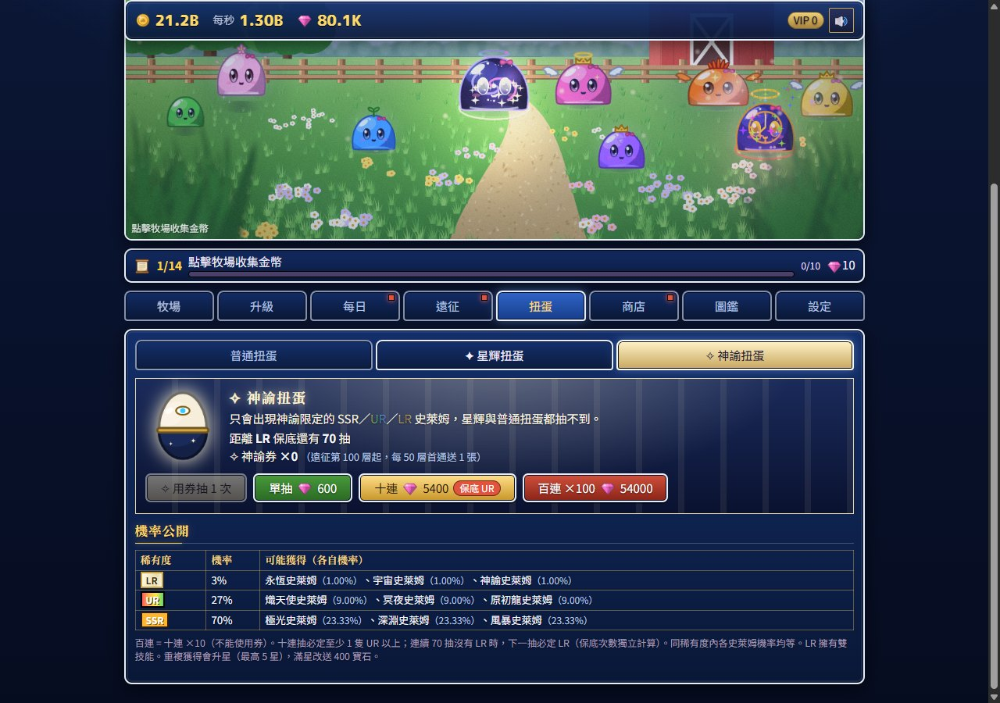
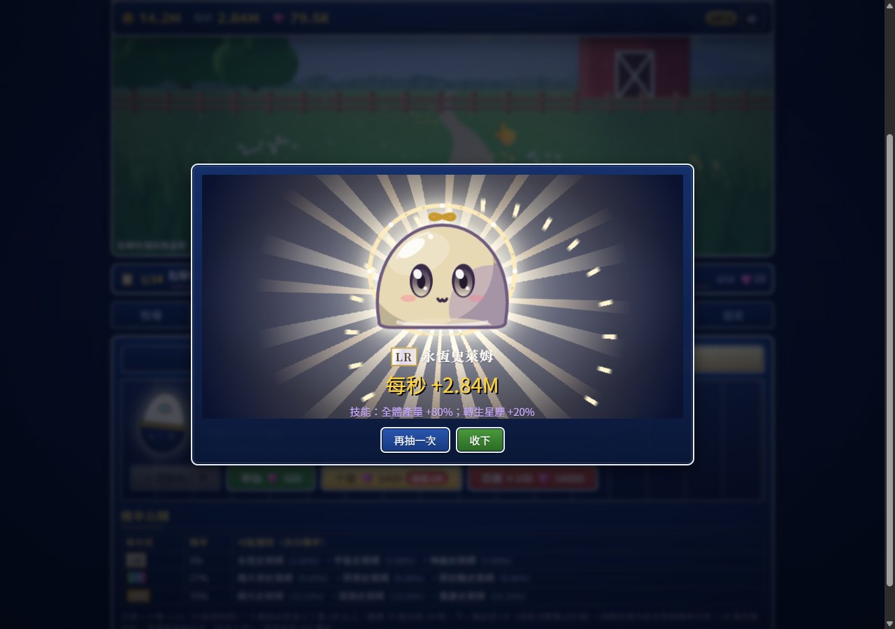

<div align="center">

# 像素史萊姆牧場 Pixel Slime Ranch

**一款由三個 AI 代理協作、人類只負責下指令，在一天內從零做到現代日系 RPG 畫風的放置養成遊戲。**
**也是一份完整公開「AI 怎麼開發遊戲」的教科書級案例。**

[▶ 立即遊玩](https://sen-capoo.github.io/idle-slime-ranch/) · [AI 開發全紀錄](docs/AI-DEVELOPMENT.md) · [給 AI 遊戲創作者的實戰手冊](docs/PLAYBOOK.md) · [架構說明](docs/ARCHITECTURE.md) · [English](README.en.md)



</div>

---

## 這個專案為什麼值得看

大部分「AI 做的遊戲」只展示成品。這個儲存庫把**過程**也一起留下來了：

- **三個 Claude Code 工作階段分工協作**：遊戲引擎、畫面、產品與驗收各有一位負責人，用一份共享的介面合約溝通，每個檔案只有一位擁有者。
- **用模擬程式驗證「好不好玩」**：不是憑感覺調數值。我們寫了一個會自己玩遊戲的模擬玩家，跑 14 天、30 天、多個隨機種子，抓出「第 3 天就沒事做」「輕課金快了 50%」這類人眼看不出來的問題。
- **每一次退回都有記錄**：哪個設計錯了、誰發現的、怎麼修、修完的數字是多少，全部寫在 [`COLLAB.html`](COLLAB.html)。包括 AI 自己犯的錯，以及 AI 互相糾正的時刻。
- **可量化的驗收標準**：畫面要「純白像素少於 5%」、手機慢 4 倍時「每秒至少 50 格」，而不是「看起來不錯」。
- **零建置、零素材檔**：純 HTML + Canvas + JavaScript，雙擊 `index.html` 就能玩。所有角色、背景、圖示都由程式繪製，所有音樂和音效都由 Web Audio 即時合成，儲存庫裡沒有任何圖片或音訊素材。

> 如果你是想用 AI 做遊戲的人，建議從 [AI 開發全紀錄](docs/AI-DEVELOPMENT.md) 開始讀，再看 [實戰手冊](docs/PLAYBOOK.md) 把方法套用到自己的專案。

## 遊戲畫面

| 牧場（草原） | 牧場（海邊黃昏） | 牧場（火山夜晚） |
|---|---|---|
|  |  |  |
| **遠征戰鬥（頭目擊破）** | **神諭扭蛋** | **LR 角色揭曉** |
|  |  |  |
| **商店** | **經典像素風格（可切換）** | **手機版** |
|  |  |  |

## 玩法一覽

| 時間尺度 | 玩家在做什麼 |
|---|---|
| 每幾秒 | 點擊收金幣（有暴擊）、抓「金色訪客」、買史萊姆、按住快速升級 |
| 每幾分鐘 | 升到 10／25／50／100 級觸發產量 ×2 的里程碑、3 隻合成下一階 |
| 每次上線 | 遠征推關：屬性相剋、弱點盾牌與 BREAK、頭目遺物三選一；自動推關與快速推關 |
| 每天 | 轉生換星塵、星塵商店、解鎖 5 個地區、每日登入與任務、圖鑑 35 種、成就 52 個 |
| 收集 | 普通／星輝／神諭三階扭蛋，N 到 LR 六種稀有度，扭蛋角色各有獨特技能 |

**課金全部是模擬的**，不連接任何金流。抽卡機率公開顯示、有保底；設計上刻意不使用虛構原價、體力限制、「差 10 元就升級」這類誘導手法（理由見 [AI 開發全紀錄](docs/AI-DEVELOPMENT.md#道德與商業的界線)）。

## 快速開始

```bash
# 1. 取得原始碼
git clone https://github.com/Sen-CaPoo/idle-slime-ranch.git
cd idle-slime-ranch

# 2. 直接用瀏覽器開啟（不需要安裝任何東西）
start index.html          # Windows
open index.html           # macOS
xdg-open index.html       # Linux
```

設定頁可以切換「現代 RPG」與「經典像素」兩種畫面風格、調整畫質與音量、匯出／匯入存檔。

### 開發者工具（需要 Node.js 18 以上；部分需要 Chrome）

| 指令 | 用途 |
|---|---|
| `node tools/sim.js . casual 14` | 模擬一位休閒玩家玩 14 天，輸出每場的決策數與空檔秒數 |
| `node tools/sim-seeds.js 30 5 f2p,light,heavy` | 5 個隨機種子 × 3 種課金程度，取中位數比較進度 |
| `node tools/regress-browser.js` | 用無頭 Chrome 以 `file://` 開啟遊戲，檢查錯誤、FPS、過曝 |
| `node tools/accept-ux.js` | 用真實滑鼠事件驗收按住升級、MAX、販賣、自動推關等 16 項操作 |
| `node tools/perf-gacha.js` | 在 CPU 降速 4 倍下量測扭蛋揭曉的流暢度 |
| `node tools/render-music.js` | 把所有配樂與音效離線輸出成 WAV，方便試聽 |

## 專案結構

```
index.html            進入點（依序載入下方腳本）
style.css             兩套 UI 主題：經典像素與現代 RPG
js/
  engine.js           遊戲狀態、數值、存讀檔、轉生、地區、成就（0b）
  shop.js             商店、三階扭蛋、VIP（0b）
  dungeon.js          遠征：屬性、BREAK、遺物、自動與快速推關（a3）
  quests.js           新手任務線（a3）
  audio.js            音效與配樂播放、介面音效（a3）
  audio-modern.js     現代風格的管弦合成樂器與原創曲目（a3）
  hd2d.js             WebGL2 合成器：景深、泛光、點光源、調色（0b）
  scenes-modern.js    現代風格的 6 個場景與標題場景（0b）
  sprites*.js         像素版／向量版角色（27）
  monsters.js         怪物（27）
  icons-modern.js     向量圖示（27）
  render.js battle.js 牧場與戰鬥的繪製（27）
  ui.js               介面（27）
tools/                模擬、回歸、效能、驗收、音樂輸出工具
docs/                 文件與截圖
COLLAB.html           三個 AI 的協作記憶與介面合約（完整開發日誌）
DESIGN-v2.html        產品設計規格（第 0 到 11 章）
HANDOFF.html          交接總結
```

更多細節見 [架構說明](docs/ARCHITECTURE.md)。

## 文件導覽

| 文件 | 給誰看 | 內容 |
|---|---|---|
| [AI 開發全紀錄](docs/AI-DEVELOPMENT.md) | 想了解 AI 怎麼做出這款遊戲的人 | 分工、溝通方式、時間軸、每個關鍵決策與錯誤 |
| [實戰手冊](docs/PLAYBOOK.md) | 想用 AI 做自己遊戲的創作者 | 可直接套用的角色分工、合約模板、驗收清單、提示詞範例 |
| [架構說明](docs/ARCHITECTURE.md) | 想讀或改程式碼的開發者 | 模組關係、事件流、渲染管線、存檔遷移 |
| [版本紀錄](CHANGELOG.md) | 所有人 | v1.0 到 v2.0 每一版改了什麼 |
| [貢獻指南](CONTRIBUTING.md) | 想參與的人 | 開發流程、程式風格、驗收要求 |

## 智慧財產聲明

v2.0 的視覺與音效參考「現代日系 RPG」這個**類型**的共通語彙（賽璐璐上色、繪本感背景、藍色漸層視窗、管弦配樂），**沒有複製**任何特定作品的角色、怪物、介面版面、標誌、旋律或音效。史萊姆是本專案自己的「圓頂果凍」造型，所有曲子都是原創旋律。規範寫在 [`DESIGN-v2.html`](DESIGN-v2.html) 第 11.0 節。

## 授權

程式碼與本專案所有原創內容以 [MIT 授權](LICENSE) 釋出。歡迎學習、修改、拿去做自己的遊戲，只需保留版權聲明。

## 致謝

- 開發：三個 [Claude Code](https://claude.com/claude-code) 工作階段（模型 Claude Opus 5.5），由人類導演 [@Sen-CaPoo](https://github.com/Sen-CaPoo) 指揮。
- 字型：[DotGothic16](https://fonts.google.com/specimen/DotGothic16)、[Noto Sans TC](https://fonts.google.com/noto/specimen/Noto+Sans+TC)、[Noto Serif TC](https://fonts.google.com/noto/specimen/Noto+Serif+TC)、[M PLUS Rounded 1c](https://fonts.google.com/specimen/M+PLUS+Rounded+1c)（皆為 SIL Open Font License，透過 Google Fonts 載入）。
- 數值設計參考：Anthony Pecorella〈[The Math of Idle Games](https://www.kongregate.com/en/pages/the-math-of-idle-games-part-i)〉系列。
