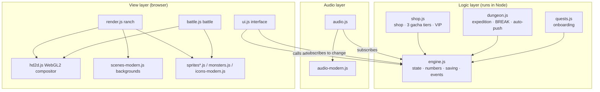

# Architecture

[正體中文](ARCHITECTURE.md) · [Back to README](../README.en.md)

*Pixel Slime Ranch* is a pure front-end project: no framework, no bundler, no server. Every module is a plain `<script>`, and modules talk through the global `window.Game`. That's what lets you double-click `index.html` and play, even over `file://`.

---

## 1. Load order

```
engine.js         Creates window.Game: state, numbers, event bus, saving
shop.js           Game.shop, Game.gacha (normal / premium / oracle)
dungeon.js        Game.dungeon (expedition)
audio-modern.js   window.AudioModern (modern-style instruments and songs; a factory)
audio.js          Game.audio (playback, music switching, UI sounds)
quests.js         Game.quests (onboarding quests)
sprites.js        window.Sprites (classic pixel characters and scenes)
monsters.js       window.Monsters
hd2d.js           window.HD2D (WebGL2 compositor)
scenes-modern.js  window.SceneModern (modern backgrounds)
sprites-modern.js window.ModernSprites (vector characters)
icons-modern.js   window.ModernIcons (vector icons)
render.js         window.Render (ranch view)
battle.js         window.Battle (battle replay)
ui.js             Interface; calls Game.start() last
```

Rule: **the logic layer (the first six) never depends on any view module**, so it can be loaded directly in Node for simulations and tests.

## 2. Layers



## 3. Event bus

`Game.on(evt, fn)` and `Game.emit(evt, data)` are the only cross-module channel. Event names are defined in the interface contract in [`COLLAB.html`](../COLLAB.html).

| Event | Emitted by | Main listeners | Purpose |
|---|---|---|---|
| `change` | Every state-changing action | ui, render, audio | Redraw the interface |
| `gold` | Taps, passive income, visitors | render (floating text), audio | Visuals and sound for income |
| `levelup`, `merge`, `buy` | engine | render, audio | Effects and sound |
| `gacha` | shop | ui (reveal) | Result array, with `.premium`, `.oracle`, `.n` |
| `dungeon`, `dungeonAuto`, `dungeonQuick` | dungeon | ui, battle | Battle result, auto-push status, quick-push summary |
| `prestige`, `zone`, `achievement` | engine | ui, render, audio | Big-moment effects |
| `offer`, `freePull`, `questReady` | engine, quests | ui | Popup queue |
| `tabConflict`, `tabResume` | engine | ui | Multi-tab guard |
| `settings` | engine | render, ui | Quality and art-style switches |

Batch operations (hold-to-level, 100-pulls) are wrapped in `Game.batch(fn)`; all `change` events inside it collapse into one.

## 4. "Compute first, then replay"

Expedition battles and gacha follow the same rule: **the logic layer computes the whole result at once; the view only replays it over time.**

```js
const result = Game.dungeon.fight();
// result.log = [{ t, uid, dmg, crit, weak, broken, shield?, brk? }, ...]
// battle.js plays the animation by t; every number shown matches the log
```

Benefits:

- The numbers on screen always match what was credited — the animation can never say "won" while the save says "lost".
- The simulator can call `fight()` thousands of times without waiting for animation.
- "Quick-push" is simply calling `fight()` repeatedly without playback.

During replay the UI sets `Game.dungeon.busy = true`, and auto-push waits until it finishes.

## 5. Render pipeline

### Classic pixel

```
each layer drawn into an off-screen 320×180 canvas → integer upscale → image-rendering: pixelated
```

### HD-2D and modern style

```
render.js / battle.js
  └─ output 7 layers: sky / far / mid / ground / actors / fg / ui
     one canvas per layer, tagged with depth (0 = nearest, 1 = farthest)
  └─ light list: [{ x, y, radius, color, intensity, flicker }]
        ↓
hd2d.js (WebGL2)
  ├─ depth-of-field blur and tilt-shift by depth (layers in the focus band are never blurred)
  ├─ bloom (captured before actors are composited, so characters don't wash out)
  ├─ point lights with halos, god rays, fog
  ├─ per-zone color grading, vignette, grain
  └─ the ui layer is composited last, with no post-processing
```

- The modern style draws at 4× resolution times DPR. Static parts of characters and backgrounds are pre-rendered and cached on load or zone change; each frame only blits.
- Without WebGL2, `HD2D.init` never touches the display canvas; render's 2D pipeline composites directly instead, so nothing breaks.
- Auto-degrade: below 40 fps for 2 seconds steps quality down (high → mid → low); once the player picks a quality manually it stops adjusting.

## 6. Audio

Everything is synthesized live with Web Audio — there are no audio files.

```
Sound:  play(name) ─┬─ classic pixel: 8-bit voices built into audio.js
                    └─ modern RPG: AudioModern.playSound() (synthesized orchestra)
Music:  startSong(name) → compose() builds an event table → pump() schedules the next 0.2 s every 25 ms
Bus:    sfx master and music mBus → compressor → output; long jingles (victory fanfare etc.) duck the music
```

- Songs are composed by motif development: a 2-bar motif → sequence → new material → cadence, with a fixed seed so each loop is identical.
- Browsers only allow sound after user interaction, so the title screen's "click to start" also unlocks audio.
- `tools/render-music.js` renders songs to WAV via `OfflineAudioContext` for listening and peak checks.

## 7. Saving and migration

- Saved to `localStorage` every 10 seconds and on page close.
- `SAVE_VERSION` is currently 10. Each save-format change bumps it and adds `MIGRATIONS[n]`, a "version n → n+1" upgrader applied in order on load.
- `Game.migrate()` uses `newState()` as the baseline: it fixes types, fills missing fields, and drops unknown slime types. Fields the engine doesn't know (e.g. `state.dungeon`) are kept as-is and repaired by the module that owns them (e.g. `ds()` in `dungeon.js`).
- If the JSON is corrupt, the raw contents are backed up to another key before starting a new game.
- Export format: `PSR1:` + base64(UTF-8 JSON).
- Multi-tab: detected via the `storage` event; the older tab pauses ticking and saving and shows "continue here".

## 8. Numbers at a glance

| System | Formula or rule |
|---|---|
| Purchase cost | `baseCost × 1.25^owned` |
| Level-up cost | `base × 1.15^currentLevel` |
| Level milestones | ×2 output at Lv10 / 25 / 50 / 100 |
| Merging | 3 of the same type at Lv≥10 plus a merge fee; result inherits the lowest level |
| Prestige | Requires ≥ 1e11 gold this run; stardust by cube root; +10% output per total stardust |
| Expedition HP | `1500 × 1.5^(f−1)`, ×1.25 per floor after 40, ×1.12 after 100; bosses ×3 |
| BREAK | Weakness hits remove shields; at 0 the enemy takes ×2 damage for 4 s, then guards for 6 s |
| Companion slots | Gacha slimes don't use main ranch slots; cap = 4 + zones unlocked + VIP bonus |

The full spec and the reasoning behind each number are in [`DESIGN-v2.html`](../DESIGN-v2.html) (Traditional Chinese).

## 9. Developer tools

| Tool | Description |
|---|---|
| `tools/sim.js` | Loads the real logic layer and simulates a player on a fake clock (`trace`, `active`, `casual N`). Env vars: `PAYER=1\|light`, `SEED=`, `NO_ORACLE=1` |
| `tools/sim-seeds.js` | Multiple seeds × player types, prints medians; `SIM_DIR=` points at another copy of the game for A/B experiments |
| `tools/regress-browser.js` | Headless Chrome, `file://`, fresh profile: desktop, mobile, mobile + CPU ×4 |
| `tools/accept-ux.js` | Verifies 16 interactions with real mouse events |
| `tools/perf-gacha.js` | Average FPS and p95 of gacha reveals under CPU throttling |
| `tools/perf-mobile.js` | Mobile performance and auto-degrade |
| `tools/render-music.js` | Renders music and sound effects to WAV (into `tools/music-preview/`, not version-controlled) |
| `tools/shot.js` | Single-page screenshot |
| `tools/hd2d-demo.html`, `tools/modern-demo.html`, `tools/modern-preview.html` | Demo pages for the compositor, backgrounds, characters and UI |

> During development each session ran its Node unit tests directly from the command line; they were not collected into test files in the repo. Contributions welcome (see [Contributing](../CONTRIBUTING.en.md)).
