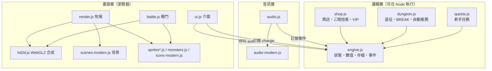

# 架構說明

[English](ARCHITECTURE.en.md) · [回到 README](../README.md)

《像素史萊姆牧場》是純前端專案：沒有框架、沒有打包工具、沒有伺服器。所有模組都是一般的 `<script>`，透過全域物件 `window.Game` 溝通。這樣做的好處是雙擊 `index.html` 就能玩，`file://` 下也能正常運作。

---

## 1. 載入順序

```
engine.js        建立 window.Game：狀態、數值、事件匯流排、存檔
shop.js          Game.shop、Game.gacha（普通／星輝／神諭）
dungeon.js       Game.dungeon（遠征）
audio-modern.js  window.AudioModern（現代風格樂器與曲目，工廠函式）
audio.js         Game.audio（播放、配樂切換、介面音效）
quests.js        Game.quests（新手任務）
sprites.js       window.Sprites（經典像素角色與場景）
monsters.js      window.Monsters
hd2d.js          window.HD2D（WebGL2 合成器）
scenes-modern.js window.SceneModern（現代背景）
sprites-modern.js window.ModernSprites（向量角色）
icons-modern.js  window.ModernIcons（向量圖示）
render.js        window.Render（牧場畫面）
battle.js        window.Battle（戰鬥重播）
ui.js            介面，最後呼叫 Game.start()
```

規則：**邏輯層（前 6 個）不依賴任何畫面模組**，所以可以直接在 Node 裡載入，用來跑模擬與測試。

## 2. 分層



## 3. 事件匯流排

`Game.on(evt, fn)` 和 `Game.emit(evt, data)` 是唯一的跨模組通訊方式。事件名稱都寫在 [`COLLAB.html`](../COLLAB.html) 的介面合約中。

| 事件 | 送出者 | 主要接收者 | 用途 |
|---|---|---|---|
| `change` | 所有改變狀態的動作 | ui、render、audio | 重繪介面 |
| `gold` | 點擊、被動產出、訪客 | render（飄字）、audio | 金幣入帳的視覺與音效 |
| `levelup`、`merge`、`buy` | engine | render、audio | 演出與音效 |
| `gacha` | shop | ui（揭曉） | 結果陣列，帶 `.premium`、`.oracle`、`.n` |
| `dungeon`、`dungeonAuto`、`dungeonQuick` | dungeon | ui、battle | 戰鬥結果、自動推關狀態、快速推關彙總 |
| `prestige`、`zone`、`achievement` | engine | ui、render、audio | 大事件演出 |
| `offer`、`freePull`、`questReady` | engine、quests | ui | 彈窗佇列 |
| `tabConflict`、`tabResume` | engine | ui | 多分頁保護 |
| `settings` | engine | render、ui | 畫質、畫面風格切換 |

批次操作（例如按住升級、百連抽）用 `Game.batch(fn)` 包起來，期間的多次 `change` 會合併成一次。

## 4. 「先算完，再重播」

遠征戰鬥和扭蛋都遵守同一個原則：**結果在邏輯層一次算完，畫面只負責依時間重播**。

```js
const result = Game.dungeon.fight();
// result.log = [{ t, uid, dmg, crit, weak, broken, shield?, brk? }, ...]
// battle.js 依 t 播放動畫，顯示的每個數字都和 log 一致
```

好處：

- 畫面顯示的數字一定和實際入帳一致，不會有「動畫說贏了、存檔說輸了」。
- 模擬器可以直接呼叫 `fight()` 跑幾千場，不用等動畫。
- 「快速推關」就是連續呼叫 `fight()` 而不播動畫。

重播期間 UI 會設 `Game.dungeon.busy = true`，自動推關會等動畫播完。

## 5. 渲染管線

### 經典像素

```
各層畫到 320×180 的離屏 canvas → 整數倍放大 → image-rendering: pixelated
```

### HD-2D 與現代風格

```
render.js / battle.js
  └─ 輸出 7 層：sky / far / mid / ground / actors / fg / ui
     每層一張 canvas，標註 depth（0 = 最近，1 = 最遠）
  └─ 光源清單：[{ x, y, radius, color, intensity, flicker }]
        ↓
hd2d.js（WebGL2）
  ├─ 依深度做景深模糊與移軸（焦點帶內的層完全不模糊）
  ├─ 泛光（在疊上 actors 之前擷取，避免角色被洗白）
  ├─ 點光源與光暈、光束、霧
  ├─ 依地區調色（grade）、暗角、顆粒
  └─ ui 層最後才疊上，不經過後製
```

- 現代風格以 4 倍解析度乘上 DPR 繪製；角色、背景的靜態部分在載入或換區時預先繪製並快取，每幀只貼圖。
- 不支援 WebGL2 時，`HD2D.init` 不會碰顯示用的 canvas，改由 render 的 2D 管線直接合成，畫面不會壞。
- 自動降級：連續 2 秒低於 40fps 降一級（high → mid → low）；玩家手動選擇畫質後就不再自動調整。

## 6. 音訊

全部由 Web Audio 即時合成，沒有任何音檔。

```
音效：play(name) ─┬─ 經典像素：audio.js 內建的 8-bit 音色
                 └─ 現代 RPG：AudioModern.playSound()（管弦合成樂器）
配樂：startSong(name) → compose() 產生事件表 → pump() 每 25ms 預排未來 0.2 秒的音符
匯流排：音效 master、配樂 mBus → 壓縮器 → 輸出；長音效（勝利號角等）播放時配樂自動壓低
```

- 曲子用「動機發展」作曲：2 小節動機 → 模進 → 新素材 → 終止式，固定種子，每次循環都相同。
- 瀏覽器規定使用者互動後才能出聲，所以標題畫面的「點擊開始」同時負責解鎖音訊。
- `tools/render-music.js` 用 `OfflineAudioContext` 把曲子輸出成 WAV，方便試聽與檢查峰值。

## 7. 存檔與遷移

- 存在 `localStorage`，每 10 秒自動存檔，關閉頁面時也會存。
- `SAVE_VERSION` 目前是 10。每次改存檔結構就 +1，並在 `MIGRATIONS[n]` 寫一個「第 n 版 → 第 n+1 版」的升級函式，讀檔時依序套用。
- `Game.migrate()` 以 `newState()` 為基準修正型別、補齊缺少的欄位、濾掉未知的種類；引擎不認得的欄位（例如 `state.dungeon`）會原樣保留，由擁有該欄位的模組自行修正（例如 `dungeon.js` 的 `ds()`）。
- JSON 損壞時，先把原始內容備份到另一個 key 再開新遊戲。
- 匯出格式：`PSR1:` + base64(UTF-8 JSON)。
- 多分頁：用 `storage` 事件偵測；舊分頁會暫停 tick 和存檔，並顯示「在這裡繼續」。

## 8. 數值設計摘要

| 系統 | 公式或規則 |
|---|---|
| 購買成本 | `baseCost × 1.25^已購買數` |
| 升級成本 | `基礎 × 1.15^目前等級` |
| 等級里程碑 | Lv10／25／50／100 各產量 ×2 |
| 合成 | 3 隻同種而且 Lv≥10，付合成費，新角色繼承最低等級 |
| 轉生 | 本輪金幣 ≥ 1e11 才能轉生；星塵依立方根計算；每點累計星塵產量 +10% |
| 遠征血量 | `1500 × 1.5^(f−1)`，40 層後每層 ×1.25，100 層後每層 ×1.12，頭目 ×3 |
| BREAK | 打中弱點扣盾；盾歸零後 4 秒內傷害 ×2，結束後警戒 6 秒 |
| 夥伴欄 | 扭蛋角色不占主線格子；上限＝4＋已解鎖地區數＋VIP 加成 |

完整規格與每個數字的由來見 [`DESIGN-v2.html`](../DESIGN-v2.html)。

## 9. 開發工具

| 工具 | 說明 |
|---|---|
| `tools/sim.js` | 載入真正的邏輯層，用假時鐘模擬玩家（`trace`、`active`、`casual N`）。環境變數：`PAYER=1\|light`、`SEED=`、`NO_ORACLE=1` |
| `tools/sim-seeds.js` | 多種子 × 多種玩家，輸出中位數；`SIM_DIR=` 可指定另一份遊戲目錄做對照實驗 |
| `tools/regress-browser.js` | 無頭 Chrome、`file://`、全新設定檔：桌機、手機、手機 + CPU ×4 |
| `tools/accept-ux.js` | 用真實滑鼠事件驗收 16 項操作 |
| `tools/perf-gacha.js` | CPU 降速下量測扭蛋揭曉的平均 FPS 與 p95 |
| `tools/perf-mobile.js` | 手機效能與自動降級 |
| `tools/render-music.js` | 配樂與音效輸出成 WAV（輸出到 `tools/music-preview/`，不納入版本控制） |
| `tools/shot.js` | 單頁截圖 |
| `tools/hd2d-demo.html`、`tools/modern-demo.html`、`tools/modern-preview.html` | 合成器、背景、角色與介面的展示頁 |

> 開發期間各工作階段的 Node 單元測試是直接用指令執行的，沒有整理成測試檔放進儲存庫。歡迎貢獻（見 [貢獻指南](../CONTRIBUTING.md)）。
